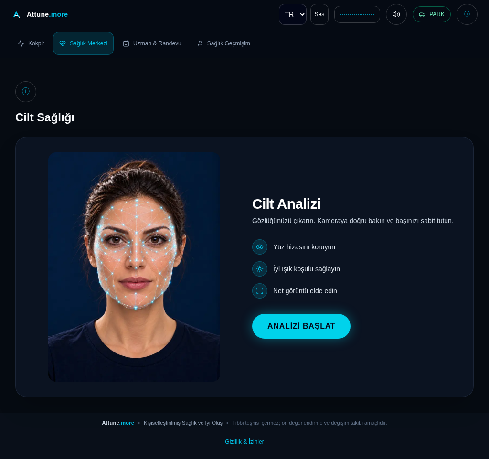

# AAOS implementation audit and OEM demo readiness — 28 October 2026

Remote `main` was fetched and verified at **`23a26e7b9c29239322240f0875aba74e5896ae53`**
before implementation. The restored checkout was `bb6088f`, 16 commits behind;
the dedicated branch `feat/aaos-demo-readiness-20261028` starts at verified main.
The intervening changes include the latest Vision speech turns, interpretation,
eye-state handling, preparation layout and localization. They are reused intact.

This delivery is a **buildable developer/OEM demonstration prototype with current
host/browser verification**. The [older emulator acceptance](acceptance/AAOS_EMULATOR_ACCEPTANCE_REPORT.md)
applies to its own recorded source and APK, not this update. This run did not
install or launch an Android device, use physical media or establish OEM approval.

## Audit and implemented corrections

| Area | Current finding and action |
| --- | --- |
| Existing architecture | Retained native Activity, restricted WebView, `VehicleDataProvider`, explicit debug backend simulation and independent `CarUxRestrictionsManager` gate. No duplicate Android project or health logic. |
| Safety | Host gate, origin, permission, stale-data and Car service regression checks pass. Background/restriction changes still destroy the WebView. Release still uses unavailable vehicle data and invalid deployment origins. Current native runtime acceptance remains blocked. |
| Main-page failures | Fixed missing HTTP-error handling: a main document returning 400+ now destroys the WebView and requires native Retry, like connection/TLS/renderer failures. Subresource errors remain with existing module error handling. Extended the emulator harness to exercise real Next.js 404 subresource/document behavior and explicit recovery. That new native scenario is prepared, not executed here. |
| Insets/keyboard | Added system-bar, display-cutout and IME inset padding on API 30+, with resize behavior and the API 29 fitting fallback. No hardcoded OEM bar size or hidden system controls. SDK compilation/lint pass; actual keyboard, cutout and OEM-bar geometry require AAOS testing. |
| Localization packaging | Disabled bundle language splitting so the native in-app TR/EN/DE selection retains its resources without a download provider. This resolves the baseline locale lint warning. |
| UI | Existing product layout passed nine routes × three languages × six usable browser viewports. No redesign was needed. Vertical scrolling remains expected; screenshots are full-page captures, not proof that all content fits in one screen. |
| Dependencies | Reused Gradle/AGP/SDK pins, frontend/backend contracts, model weights, approved audio and storage. No production dependency, speech provider, model, threshold, Windows launcher or deployment was changed. |

## Verification from this execution

| Check | Observed result |
| --- | --- |
| Verified-main Android baseline | Debug assembly and lint pass in a separate temporary source export. Baseline lint: 0 errors, 2 warnings. |
| Updated Android | `scripts/automotive/build.sh`: debug assembly/lint pass; `:app:assembleRelease` also passes. Final debug lint: 0 errors, 1 existing `SetJavaScriptEnabled` warning. JavaScript is required by the existing React app; its origin/permission boundaries remain enforced. |
| Debug APK | 64,978 bytes; SHA-256 `11f9a6cf86c5e72c03f647250782917836f0c220d7f988e44de0268c4b52d756`; signature verification passes. APK contains the shell, not an offline frontend/backend bundle. |
| Automotive host suite | 91 passed, 31 subtests passed; both formerly compiler-dependent skips executed with the full JDK. |
| Java policies | 69 checks pass; all nine Android Java sources parse. SDK compilation separately verifies Android types. |
| Node WebView observer tests | 8 passed, including rejection of wrong HTTP prerequisites and unexpected live-page errors. Fixtures do not establish Android acceptance. |
| Frontend | Production build, TypeScript and lint pass. |
| Browser/API reuse | 216 checks pass: 162 route/layout observations plus 54 actual backend-simulation transition/offline/recovery observations. No health analysis or media capture. |
| Browser assets | 235 checks pass: eight MediaPipe model/loader assets served with matching hashes, three included WASM binaries compile, and 227 guidance/original recordings match hashes and decode through Web Audio. No inference, audible output, acoustic quality or WebView codec acceptance follows. |
| Source audio packaging | All 227 recordings in the existing automotive packaging gate match their approved manifests. Other audio catalogs are retained; these counts are not a complete auditory review of every catalog. |
| Unit regressions | Final full suite: **1,797 passed, 44 skipped**, 0 failures. Skips require Windows ABI/Job Objects or unavailable licensed/historical fixtures. Setup history is recorded in `evidence-20261028/validation.json`. |
| Current AAOS emulator/device | **BLOCKED:** no `/dev/kvm`, no preinstalled emulator/AVD/system image. The existing controlled harness requires KVM and Ubuntu 24.04; this Cloud host is Debian 13. A multi-gigabyte image was not downloaded to attempt an unsupported run. No hosted emulator workflow was dispatched. |

Toolchain: Temurin JDK 21.0.13+9, Gradle 8.11.1, AGP 8.9.2, SDK 35,
build tools 35.0.0, Node 22.20.0, npm 10.9.3, Python 3.11.17 and Chrome
155.0.8059.84. The SDK command-line tools and JDK were downloaded from official
distributions and verified against their published checksums. The system Java
installation lacked compiler executables; all final Android/host checks use the
complete workspace JDK. No toolchain was installed on Windows.

## Five-module compatibility matrix

Every row is **partially verified overall**: current browser/host behavior passes,
while current native functional acceptance is blocked. No physical capability is
inferred from backend simulation fields or desktop Chrome APIs.

| Module | Verified in this run | Partial / blocked acceptance |
| --- | --- | --- |
| Skin | TR/EN/DE entry/history layout; existing unit/backend regressions; MediaPipe HTTP hashes/WASM compilation; consent and unavailable-model handling in host tests | Current AAOS camera, inference, alignment, cancellation during active capture and device performance blocked. |
| Dental | TR/EN/DE entry/history layout; pipeline/contracts and persistence regressions; photo-store browser regression | Native camera/multi-pose inference blocked. Existing native file-picker refusal remains explicit; desktop upload behavior is preserved. |
| Vision | Latest merged spoken-turn/eye-state/interpretation/localization regressions; TR/EN/DE entry/history layout; local model availability | Current WebView camera/worker execution and Web Speech recognition blocked. Missing recognition must remain an unavailable state, with no manual eye override or replacement provider. |
| Hearing | TR/EN/DE entry/history layout; existing protocol, scoring, persistence and localization regressions; checked audio codecs decode in desktop Chrome | Actual AAOS output routing, stereo/headphones, audible playback, volume and calibration blocked. Browser decode is not a hearing test. |
| Mental | TR/EN/DE entry/history layout; existing structured conversation, consent, safety and speech regressions | Native recognition, current on-device recorded/neural speech, active audio interruption and provider availability blocked. No provider keys, paid calls or new voices used. |

Dashboard, care, profile and privacy route layouts also pass at all tested
language/viewport combinations. Full physical accessibility, rotary navigation,
all forms, 200% zoom and native keyboard behavior remain unverified. Existing
privacy/history/deletion tests are host/browser evidence, not on-device persistence
acceptance.

## Evidence and reproduction

[Machine-readable validation](evidence-20261028/validation.json),
[216 browser observations](evidence-20261028/results.json) and
[235 browser asset observations](evidence-20261028/browser-assets.json) accompany
six selected screenshots in this PR. Screenshot file names identify language and
**browser viewport**, and every image is from desktop Chrome with native CSS
injected. They contain existing product illustrations and synthetic empty history.
All 162 PNGs and their result files are also supplied in the local delivery ZIP.

See the [OEM demo guide](OEM_DEMO_GUIDE.md) for exact backend, frontend, tunnel,
build and launch commands, plus the remaining native acceptance scenarios.

## Official documentation review and integration boundary

Reviewed on 28 October 2026 through the connected web tool (the shell proxy denies
`developer.android.com`):

- [Android for Cars supported categories](https://developer.android.com/training/cars): wellness is not a listed category. Using a WebView does not make Attune.more a browser app. Developer sideloading and an OEM demonstration do not confer Google Play eligibility.
- [Parked AAOS apps](https://developer.android.com/training/cars/parked/automotive-os): preserve lifecycle interruption, platform restriction checks, explicit navigation, and capability-dependent operation. Gear/speed simulation does not determine platform UX restrictions.
- [View insets](https://developer.android.com/develop/ui/views/layout/edge-to-edge): target 35 requires inset handling on Android 15+. The new padding uses reported bars/cutouts/IME rather than manufacturer-specific dimensions.
- [AAOS emulator testing](https://developer.android.com/training/cars/testing/emulator): use an actual Automotive image; also verify distraction behavior on an image without compatibility mode.

Remaining before genuine vehicle/OEM integration: current native acceptance of
the new HTTP/inset behavior and all five modules; authorized real vehicle signal
provider with freshness/disconnect semantics; per-vehicle camera/microphone/audio
capability and permission acceptance; secure authenticated deployment; storage and
privacy review on-device; supported distribution agreement/path; release signing,
update/recovery and appropriate clinical/regulatory review. No proprietary TOGG,
BMW, Audi or Volkswagen API, approval or partnership is claimed.
