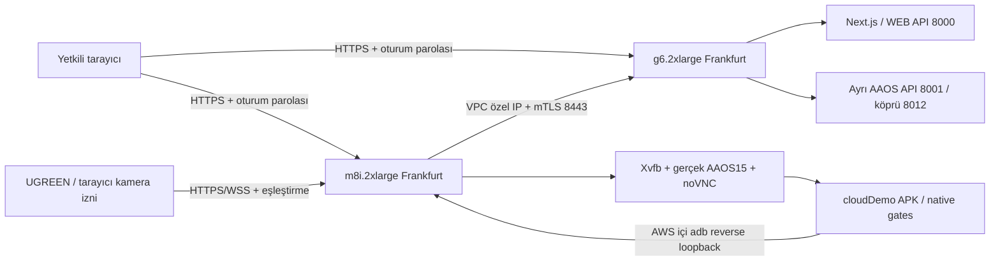

# Task 13 — AWS OEM demo hazırlığı (2026-11-03)

**Durum: HAZIRLIK / BLOCKED. AWS deployment veya beş modül kabulü tamamlanmadı.**
Ücretli kaynak oluşturulmadı/başlatılmadı. DNS değiştirilmedi. Kullanıcı son mesajında ücretli başlatmayı açıkça yasakladı.

## Başlangıç ve koruma

GitHub API ve `git fetch origin main` ile doğrulanan ana dal:
`9db8abaa324610b1852364ea8848bbb05fff9643`. Çalışma dalı
`codex/aws-oem-demo-20261103`, ayrı Cloud worktree `/workspace/attune-aws`.
PR #21 başlangıçta açık, başı `c7f2168306797e4c0856d4f1dd7dbcd33f0d0f04`.
Bu PR'ın dalına, Windows Latest/Original kurulumlarına veya ana dala yazılmadı.
PR #21 birleşirse mevcut main ile uzlaştırma ve ilgili testlerin tekrarı zorunlu.

Drive proje kökü, AG arşivi, CED handoff ve Claude arşiv klasörleri okundu.
Eski handoff'un model adları/hash'leri güncel Git manifestleriyle birebir aynı değil:
örneğin güncel Dental `dental-yolox-s.onnx` ve Skin Type `skin-type-local-v1/model.onnx`.
Eski handoff tablosundaki `best.pt` veya başka bir ViT ağırlığı sessizce ikame edilmez.
Çalışan modelin otoritesi mevcut kodun yüklediği manifest ve hash doğrulamasıdır.

## Hazırlanan mimari

CloudFormation şablonu: `infra/aws/stack.json`. G6 8 vCPU/32 GiB/L4; M8i
2xlarge 8 vCPU/32 GiB, `NestedVirtualization=enabled`. M8i 8 Standard vCPU
ayrıca doğrulanmalı. 150 + 100 GiB şifreli gp3, iki kalıcı Elastic IP,
VPC/IGW/subnet, yalnız 443 genel giriş; 8443 yalnız M8i güvenlik grubundan G6'ya.
SSH, ADB, VNC, emulator/gRPC portları internete açılmaz. IMDSv2 zorunlu.
SSM yönetimi, proje/task/owner/cost-center etiketleri ve aylık bütçe bildirimleri
şablonda yer alır. Bütçe account-wide seçilmiştir; etiket aktivasyonu beklenmez.
Bütçe bir harcama tavanı değildir; otomatik durdurma yoktur.

İki makinenin public IP'si yalnız HTTPS erişimi ve outbound internet için kullanılır;
uygulamalar arası veri özel VPC IP'si üzerinde mTLS ile taşınır. NAT Gateway,
ALB ve 24/7 ek yönetim sunucusu planlanmadı. EIP değişmeyen DNS hedefidir.
Şablon bare host oluşturur; AMI ve AZ tahmin edilmez, parametre olarak doğrulanır.
`install_host.sh` işletim sistemi hazırlığıdır; sertifika, model ve ayarlar hazır
olmadan servis başlatmaz. Tam otomatik deployment kabulü yapılmadı.

## Uygulama ve oturumlar

`NEXT_PUBLIC_ATTUNE_SAME_ORIGIN_API=1` build'inde istekler `/api/...` olur;
loopback override ile birlikte kullanım build hatasıdır. CSP localhost'a bağlantı
açmaz. TR/EN/DE dil parametresi aynı-origin API'ye de uygulanır. Normal lokal
build davranışı korunur. Caddy API dokümantasyonunu dışarı kapatır, yanıtları
cache etmez. TLS doğrulaması hiçbir aşamada devre dışı bırakılmaz.

Mevcut backend çok kiracılı değildir. Bir seferde **bir OEM toplantısı** vardır;
WEB ve AAOS ayrı backend process kullanır (araç durumu ve bellekteki kayıtlar
karışmaz). Toplantı katılımcıları aynı yetkili demo oturumunu paylaşır; bağımsız
kişisel hesap vaadi yoktur. Her toplantıda parola döndürülür, tarayıcı için temiz
profil kullanılır, guest uygulama verisi toplantıdan sonra onaylı demo temizliğiyle
silinir. Aynı toplantıda kapanıp açılma için guest disk korunabilir; kalıcı saklama
kullanıcının mevcut fotoğraf/kayıt onayına tabidir. Backend Mental belleği process
restartında kaybolur; IndexedDB/localStorage kayıtları ilgili browser/guest
profiline bağlıdır. Sunucu veritabanına geçiş veya merkezi hasta arşivi eklenmedi.

`cloudDemo` APK debug-türevi ayrı paket kimliğidir; üretim/OEM release değildir.
Native CarUxRestrictions, GatePolicy ve 2.5 saniyelik observation sınırı değişmez.
Backend araç sağlayıcısı hâlâ açıkça etiketlenmiş simülasyondur; gerçek OEM CAN/VHAL
entegrasyonu değildir. Platform AAOS UX kısıtlaması ayrıca gerçek Car API üzerinden
uygulanır. İki gate de PARK demeden WebView açılmaz. Bulut APK localhost'u Windows'a
değil AWS guest→M8i reverse tüneline bağlar; M8i→G6 mTLS olur. Release origin
`attune.invalid` olarak kapalı kalır.

## Kamera köprüsü — deneysel, kabul bekliyor

`NEXT_PUBLIC_ATTUNE_REMOTE_CAPTURE=1` ve `AttuneCloudDemo/1` APK işareti birlikte
olduğunda Skin/Dental acquisition açıkça uzak demo kaynağını seçer. İşaret bir
kimlik doğrulama mekanizması değildir; ingress kimlik doğrulaması/mTLS ayrı zorunlu.
AAOS eşleştirme kodu üretir; gönderici HTTPS `/capture` sayfasında kodu ve ayrıca
kamera/işleme iznini verir. Kamera iznindeki aygıt seçimi UGREEN'i belirler.

Köprü PNG karelerini RAM'de, tek karelik akışla taşır. Modeller gönderici laptopta
çalışmaz. MediaPipe/geometri mevcut AAOS WebView'da, analizi mevcut G6 backend'inde
çalıştırmak amaçlanır. Rastgele ayrı sender/receiver yetenekleri, origin denetimi,
tek receiver/sender, sunucunun her kare için ürettiği challenge, boyut/freshness
sınırları vardır. PARK kaybı, bağlantı kesilmesi ve izin iptali akışı sonlandırır.
Pairing 120 saniye, canlı eşleşme en çok 30 dakika sürer; yeni tarama yeni eşleşme
ister. Bu kamera süresidir, EC2 otomatik kapatma değildir.

Skin/Dental mevcut görüntü hash'i, poz, yüz/kalite/gözlük/işleme onayı ve geç sonuç
kontrollerinden geçer. Kaynak oturum kimliği `inputSource` ile görüntüye eklenir.
PNG köprüsü native YUV/HAL gibi gösterilmez; remote Skin capture `browser-rgb`
yolunu kullanır. Kaynak kare renk/parite etkisi gerçek kamera ile ayrıca ölçülmeli.
Hiçbir analiz sonucu köprüde üretilmez veya değiştirilmez. Taşıma testleri gerçek
Skin/Dental çıkarım kanıtı değildir. Tarayıcı PNG encode hızı ve ağ gecikmesi 750 ms
sınırını aşarsa oturum hata verir; eşikler gevşetilmez.

## AAOS görüntü/ses sınırı

Gerçek API35 automotive SDK image mevcut depodaki resmi paketle seçilir:
`system-images;android-35-ext15;android-automotive;x86_64`. Boot script API35,
automotive feature, KVM, APK hash ve kamera servis envanterini kaydeder.
Camera HAL'ın çalıştığı iddia edilmez; `-camera-back` bunu garanti etmez.

noVNC gerçek emulator X11 ekranına mouse/keyboard ile erişim hazırlığı sağlar.
**noVNC ses taşımaz. Hearing ve Mental uçtan uca ses kabulü BLOCKED.**
Bu nedenle opsiyonel `/audio` sayfası + `audio_bridge.py` ayrı HTTPS/WSS PCM kanalı
hazırlandı. PulseAudio monitor cihazı emulator çıkışını taşır; ayrı onay verilen
mikrofon, emulator giriş kaynağına gider. Sabit 48 kHz, bounded buffer ve invalid
PCM reddi vardır. Gerçek guest routing, cihaz seviyesi ve gecikme/kalibrasyon testi
olmadan bu iki modüle AAOS PASS verilemez. Bu yol resmi goldfish WebRTC değildir.
Mikrofon sağlayıcısı ve Mental gerçek provider onayları da ayrı doğrulanmalıdır.

## Teknik kaynaklar

- [AWS nested virtualization](https://docs.aws.amazon.com/AWSEC2/latest/UserGuide/amazon-ec2-nested-virtualization.html): M8i/KVM ve CPU seçeneği doğrulandı.
- [AWS CloudFormation CPU options](https://docs.aws.amazon.com/AWSCloudFormation/latest/TemplateReference/aws-properties-ec2-launchtemplate-cpuoptions.html).
- [Resmi AAOS cloud emulator](https://source.android.com/docs/automotive/start/avd/cloud_emulator): gerçek emulator + uzaktan giriş/video mimarisi. Eski örnek görüntüler API35 kanıtı değildir.

Ayrıntılı erişim: [AWS-ACCESS.md](AWS-ACCESS.md). İşletim: [OPERATIONS.md](OPERATIONS.md).
Kabul durumu: [ACCEPTANCE.md](ACCEPTANCE.md).
