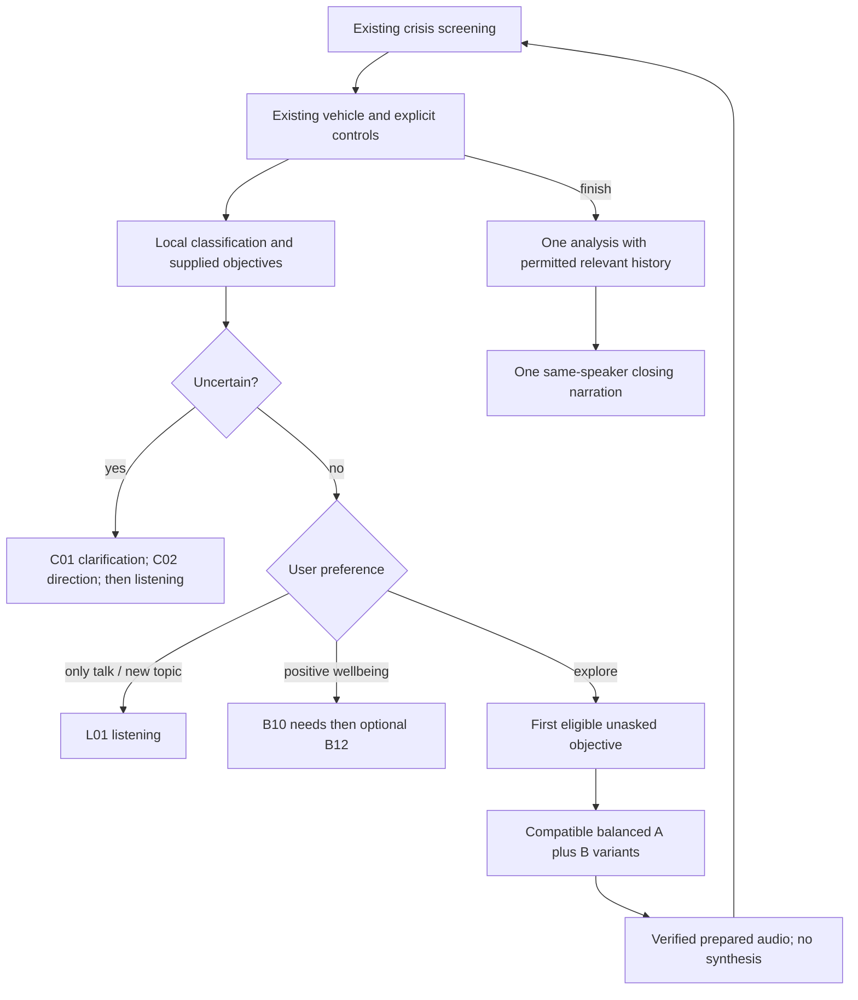

# Structured wellbeing conversation v1

This is an implemented, disabled-by-default development path. **It is not release-ready.** Nine representative recordings and six lossless joined previews are available on the [listening sheet](listening/README.md), awaiting explicit owner approval; 405 scripts remain ungenerated. The classifier needs a measured semantic-model comparison and broader evaluation, and the multilingual content needs owner/native-language review. No clinical validation is claimed. The existing conversational experience remains the default. See the [follow-up review](followup-review.md) for provisioning, expanded benchmarks, flow fixes and current blockers.

## Repository audit (27 October 2026)

The remote repository metadata and `git ls-remote --symref origin HEAD` confirm `main` as the default branch. Work began from an older checkout and was rebased onto current `origin/main`, `84ccea4a83ca4eafb751b66dcf5bd2963a8f0fb4` (merged PR #11), before implementation. Merged PRs #9–#11 concern skin/dental work; those changes are preserved. The open PR search returned draft #6 (skin/localization research); active remote refs also include hearing, localization and automotive branches. Their historical descriptions were not treated as the current implementation. No unrelated branch was merged into this work.

| Existing integration | Audit finding and implementation |
| --- | --- |
| `services/core-api/mental_provider.py` | Ordinary live replies use `OpenAICompatibleMentalProvider`; analysis already uses a separate analyzer. Extend that analyzer only for requests selecting structured mode. The shared OpenAI client has `max_retries=0`. |
| `services/core-api/main.py` | `/api/mental/converse` runs `check_mental_crisis` before provider routing, followed by `conversation_control` when parked. Preserve this precedence. Structured responses branch before provider configuration checks, requiring no conversation API key. |
| `services/core-api/mental_context.py` | Existing long conversations can call OpenAI to compact exact user quotations. Structured mode bypasses compaction and retains the complete bounded transcript in browser memory until completion. |
| `apps/vehicle-app/src/utils/useMentalConversation.ts` | Existing epoch/session gates, recognition, pause/resume, abort controllers, saving consents, vehicle transition cancellation and audio lifecycle are reused. Structured state is volatile and never stored as an unrestricted transcript. |
| `mentalHistory.ts`, `healthRecords.ts` | Existing schema version 3 consumers remain compatible. Optional recommendations, related IDs and recurring themes are additive. Existing summary/transcript permissions still govern storage. |
| `serviceConsent.ts`, `attuneMode.ts` | Existing recognition, OpenAI conversation/summary and speech consent remain required. A separate unchecked opt-in permits relevant saved summaries to be sent for analysis; summary storage permission alone never enables this. |
| `approvedAudio.ts`, `fixedAudio.ts`, `fixedFileSpeech.ts` | Reuse verified-byte fetching, playback, metering, mute, document visibility, audio focus and abort behavior. Add PCM WAV to the existing clip type. Prepared conversation mapping uses stable asset IDs rather than matching translated text. |
| `mentalNeuralSpeech.ts`, same-origin neural proxy | Ordinary structured turns bypass dynamic speech completely. Only completion requests dynamic speech, explicitly bound to `official-default`, with the existing finite generation/playback deadlines and gesture recovery. |
| `mental_neural_tts.py`, `mental_neural_worker.py` | Runtime pins official Chatterbox source revision `5de7a54aa4e5e2baadb0182dde554908b48b85c2`, model `t3_mtl23ls_v3.safetensors`, offline loading and internal `conds.pt`. Reuse this exact worker for production. Batch jobs optionally seed Python, NumPy and Torch. |
| `SAFETY.md`, shared crisis rules | No change to crisis detection, escalation, emergency number or driving policy. Ordinary structured routing never intercepts a crisis. The actual frontend closes conversations on motion rather than beginning an interview while driving; the backend additionally returns a short prepared driving/pause response. |

## Evidence-informed interview design

Sources were inspected on 27 October 2026. These methods inform interaction choices; they do not validate this software or authorize it to deliver psychotherapy.

* [Rogers (1957), original bibliographic record](https://pubmed.ncbi.nlm.nih.gov/13416422/) and [reprinted original abstract](https://pubmed.ncbi.nlm.nih.gov/22122245/): respect the person's perspective. Our short acknowledgments avoid claiming knowledge of unexpressed feelings. This software does not claim to reproduce a therapeutic relationship.
* [SAMHSA TIP 35, chapter 3 (2019)](https://www.ncbi.nlm.nih.gov/books/NBK571068/): open questions, affirmations, reflective listening and summaries (OARS), avoiding interrogation and premature action planning. The design allows skips, listening without advice, early completion and user-chosen steps. Generic acknowledgments are not represented as individualized reflective listening; individualized synthesis occurs only at completion.
* [Beck Institute, understanding CBT](https://beckinstitute.org/about/understanding-cbt/): distinguish situations, thoughts, emotions and behavior. We ask about these separately and never assert distorted thinking, dispute beliefs, assign a diagnosis or prescribe treatment.
* [WHO PM+ intervention manual, field-trial version 1.1 (2018)](https://www.who.int/publications/i/item/WHO-MSD-MER-18.5) and [WHO training manual (2025)](https://www.who.int/publications/i/item/9789240109926): practical coping and social resources inform the optional resource/needs questions. PM+ is an intervention with training and supervision requirements. This flow does not implement PM+, its treatment schedule, assessment scales or efficacy claims.

The semi-structured design separates stable information objectives from their exact spoken wording. Situation precedes emotional exploration; impact and frequency precede optional deeper exploration. Positive wellbeing follows a shorter route. B06 asks recent frequency consistently; it does not mix frequency and change-over-time questions. B02/B05 variants consistently ask about the described event rather than mixing past and present meanings. Progression, emotional change and cross-session relationships are analyzed only when supported by the user's statements. No objective must be answered.

The complete executable transition specification is [`shared/mental/v1/flow.json`](../../shared/mental/v1/flow.json); content is [`shared/mental/v1/content.json`](../../shared/mental/v1/content.json). There are 12 global A phrases and 120 B variants per language, plus six control/clarification/listening phrases per language: 414 scripts. IDs and psychological subtypes match across TR/EN/DE. The content remains a draft for native-language and methodological review.



The router keeps `asked`, `fulfilled`, `skipped`, `clarifyFor`, `aHistory` and exact response/asset IDs. Browser sessions get a fresh random seed; tests can supply deterministic seeds. Optional flow-version/seed/selection metadata follows existing summary-saving consent. Fulfilled or already asked B nodes cannot be selected again. New information can fulfill multiple objectives at once. C01 is a separate clarification node; repeated uncertainty becomes C02 then listening, without repeatedly asking the original B node. Explicit controls use the existing parser with affirmative EN/DE extensions; colloquial end/pause expressions outside its coverage are not falsely interpreted as commands. Pause preserves the interrupted objective. A later explicit request for next steps can leave listening-only mode. Topic change preserves completed objectives and lets the user lead instead of restarting all twelve questions. B11 requires explicit interest in steps/advice. B12 is optional and skippable. Finishing never requires a reflection.

## Local classifier selection and limits

| Candidate | Language/offline support | Resources/licensing | Evidence for this task |
| --- | --- | --- | --- |
| Implemented character 3/4-gram prototype retrieval + dialogue/grammatical rules | TR/EN/DE authored examples; fully offline | Python standard library + existing Pydantic, CPU; repository license, no model weights | Measured development probes in `evaluation.json`; misses colloquial and ASR examples. Negation abstains from sentiment; contradictory or unclear answers clarify. Contextual answers can fulfill the current objective. |
| [Multilingual MiniLM L12 v2](https://huggingface.co/sentence-transformers/paraphrase-multilingual-MiniLM-L12-v2) | Model card advertises 50 languages and 384-dimensional sentence embeddings; downloadable for offline inference | Apache-2.0; requires tokenizer and transformer runtime/weights. CPU deployment possible; GPU optional. Latency and RAM were not measured here. | Plausible semantic retrieval candidate, not downloaded or benchmarked on these objectives. No claim of TR/EN/DE conversational accuracy. |
| [Multilingual E5 small](https://huggingface.co/intfloat/multilingual-e5-small/raw/main/README.md) | Card lists TR/EN/DE and multilingual embeddings; offline after provisioning | MIT; needs pinned tokenizer/weights and inference runtime. CPU possible; GPU optional. Actual latency/RAM unmeasured. | Candidate for semantic objective retrieval with task-specific examples and calibrated thresholds. Public benchmarks do not establish wellbeing interview accuracy. |

The implemented option avoids adding a large unverified runtime dependency. It is **not a semantic transformer classifier**. Prototype similarity improves over exact keywords, but objective extraction still depends substantially on authored patterns and dialogue position. Negation prevents opposite-sentiment inference, while an explicit negated emotional report can still supply information. Topic cosine threshold is 0.30 with a 0.06 margin; objective routing threshold is 0.75. Objective scores 0.85/0.25 are uncalibrated rule confidence, not probabilities. Arbitrary multiword replies to an open question may be mistaken for answers; this is a release blocker until a broader, independently labeled TR/EN/DE corpus establishes acceptable behavior. Do not enable production on the strength of this small fixture set.

`scripts/mental_structured_evaluate.py` contains 18 authored development probes, including three deliberately difficult colloquial/ASR cases. It reports omissions rather than deleting failing probes. These are not held-out validation or clinical accuracy. Related history uses the existing stable session-theme vocabulary as a conservative relevance filter; it excludes the generic daily-sharing category and uses at most five permitted summaries. Broad theme overlap is not proof of a historical relationship; the analysis must still support each relationship and output IDs are intersected with provided IDs.

## Audio production and approval

The versioned manifest is `apps/vehicle-app/public/audio/mental/v1/manifest.json`. Paths are `/audio/mental/v1/{tr,en,de}/official-default/{A,B01...B12,...}/{variant}.wav`. It includes exact scripts, language, objective, speaker, codec, sample rate, nullable production measurements and explicit pending status. No fabricated duration or hash is populated.

The speaker is the existing internal `official-default` conditioning, SHA-256 `6552d70568833628ba019c6b03459e77fe71ca197d5c560cef9411bee9d87f4e`. Closing speech verifies this same `conds.pt` fingerprint using the existing configuration loader before inference. The backend, proxy and client carry/verify the speaker profile header. The pipeline uses a recipe hash including script, language, content/model/source versions, conditioning and deterministic seed. Repeated production skips an identical existing asset; mismatch or missing approved audio fails without regeneration. Seed reproducibility does not promise identical bytes across hardware/runtime versions; recorded hashes identify the actual accepted bytes.

```sh
# Plan only; no synthesis or paid calls:
python scripts/mental_audio_batch.py

# With the already provisioned pinned runtime and verified model bundle:
python scripts/mental_audio_batch.py --generate --config /absolute/path/config.json --python /absolute/path/runtime/python

# Full production only AFTER owner sample listening approval is recorded:
python scripts/mental_audio_batch.py --generate --all --config /absolute/path/config.json --python /absolute/path/runtime/python
```

The representative set is A-V01, B01-V01 and B02-V01 in each language (nine clips). The existing official offline archive has now been provisioned: all 98 parts, the archive hash and 117 members verified against the existing policy. The isolated pinned CPU runtime passed `pip check`, and all nine clips were generated with the existing V3 model and conditioning. The [listening sheet](listening/README.md) provides actual recordings and lossless join previews. All remain unapproved; no substitute voice or mass production was used.

When provisioned, the pipeline writes lossless mono 24 kHz PCM WAV, records duration, bytes, SHA-256, peak, RMS and clipping count, and marks output `synthesized-awaiting-listening-review`. It never marks audio approved. Scripts must match the content catalog before generation. Sample acceptance must record an owner timestamp in `sampleApproval.ownerApprovedAt` and each sample's approval status, and multilingual content must be approved before `--all`. Record reviewer identity and review notes alongside that timestamp. Approval is a human action, not a synthesis exit code. Do not change previously accepted recording bytes; fixes require a new version.

Review each language for pronunciation, language switching, warmth, speaker consistency, loudness, clipped/truncated words and silence boundaries. Review joined A+B phrases for rhythm, intonation and breath placement; the 120 ms join is an **uncalibrated starting value**. Incompatible A prefixes are excluded in `compatibleAPhrases`. No precomposed combinations are included or claimed necessary until listening shows a problem. If a combination fails, exclude it or create a separately versioned precomposed clip with explicit mapping and tests before enabling it. Neither the router gate nor frontend will play a draft/unapproved library. Set content `reviewStatus`, per-entry approval and `joinApprovalStatus` only after actual reviews, retaining acceptance evidence.

## Integration, privacy and lifecycle

Opt-in build/runtime configuration:

```text
NEXT_PUBLIC_MENTAL_CONVERSATION_ENGINE=structured-v1
ATTUNE_MENTAL_STRUCTURED_ENABLED=1
```

Both flags are off by default. Even with flags on, the backend rejects structured conversation until content, recordings and joins are approved. There is no automatic legacy/LLM/TTS fallback. Reverting the flags restores the unchanged legacy route for new sessions; no data migration is needed. Change flags at a session boundary. Existing explicit browser-system voice remains available in legacy mode; structured mode requires the Chatterbox selection to maintain voice identity.

Ordinary browser requests still visit the existing self-hosted backend for crisis verification and CPU routing; they are not fully browser-offline interactions. They make no external generation requests. Browser speech recognition may use the device/vendor cloud under the existing recognition consent. Asset retrieval can use the application's static server. These are separate from LLM/TTS generation cost.

The frontend completes at turn 39 or approaches 100,000 transcript characters using a prepared closure. A crossing utterance is preserved verbatim for analysis, rather than discarded or routed through another ordinary generation request. A 94,000-character soft threshold reserves room for bounded final input and closure, within the backend 200-message/120,000-character analysis limit. Completed transcripts go to analysis once. Incomplete, failed, empty or crisis sessions do not become successful saved sessions. No background transcript storage was added.

Historical processing is off unless explicitly selected, service/cloud processing remains allowed, summary saving remains permitted, and prior records are completed/consented schema 2/3 summaries. Prior transcripts are never sent. Context is filtered server-side by stable themes. Revoking history permission during completion cancels the request; withdrawal of service/cloud permission, locale changes, motion, mute, visibility and session epoch guards continue to cancel work/playback. Locale/voice changes require a new structured session rather than mixing recordings. At closure, speech is generated once and visible analysis is retained on audio failure; no rewrite call or automatic TTS retry occurs. Muted/cancelled sessions may make zero closing requests. Duplicate finish actions within the mounted session are ignored; there is no new persistent server idempotency cache or exactly-once guarantee across reloads/network replay.

Strict additive analysis fields include `recommendations`, `relatedSessionIds`, `recurringThemes`, `spokenSummary` while preserving existing summary/theme/mood/support fields. A malformed response fails without retry. Returned related IDs must be from permitted input; recurring themes must be current themes and present in a related summary. No-advice mode suppresses the recommendation array and instructs the analyzer to omit advice in speech. Free-text grounding still requires conversational evaluation; schema checks cannot prove all prose is supported.

## Verification and release gates

See `validation.md` for executed checks and `evaluation.json` for CPU routing measurements. All external generation in tests is mocked. The ordinary path's 0 OpenAI / 0 dynamic TTS and completion's 1 analysis / 1 dynamic TTS are verified by executed lifecycle closures and analyzer call counters, not by billing data. Existing SDK retries remain disabled. Crisis/vehicle/mute/no-consent/audio-failure paths are explicit exceptions to the successful-session 1/1 target.

Unfinished release work: owner listening approval of the nine generated clips and joins; native TR/EN/DE and methodological content review; measured MiniLM/E5 comparison in an environment using the published allowlist; then approved full-library production and combination listening, broader real ASR/usability evaluation, and physical browser/vehicle checks. The expanded 180-utterance rule benchmark and official download/benchmark runner are in the follow-up review. Sample-generation wall time/RSS are measured in the manifest; actual token usage, API billing savings, dynamic-closing end-to-end latency, GPU utilization and perceptual quality remain unmeasured. Do not merge or deploy without explicit owner approval.
